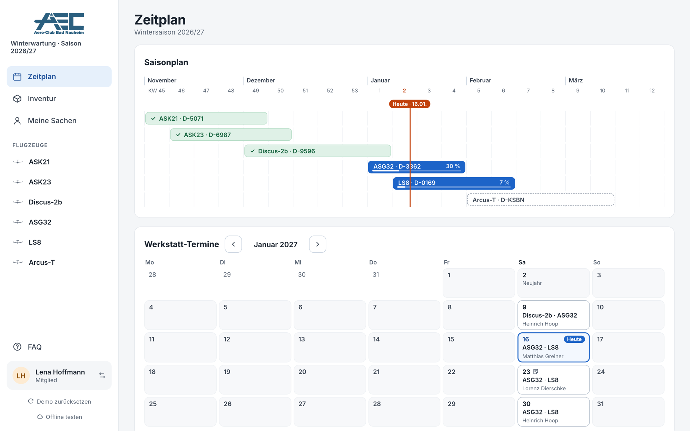

# Vereins-Wartung · Winterwartung für Segelflugvereine

Web-App, mit der ein Verein die Winterwartung seiner Segelflugzeuge plant und nachvollzieht:
wer arbeitet wann an welchem Flugzeug, was ist erledigt und abgezeichnet, welche Mängel sind offen und was muss bestellt werden.
Alles an einem Ort – am Werkstatt-Tablet genauso wie zu Hause im Browser.

Entstanden für den **Aero-Club Bad Nauheim** (läuft dort unter [wartung.aecbn.de](https://wartung.aecbn.de)).
Jeder Verein kann die App auf einem eigenen Server mit eigenem Namen und Logo betreiben, siehe [Eigener Server](#eigener-server).


<details>
<summary>Zeitplan mit Saisonplan und Werkstatt-Terminen</summary>


</details>

**Demo mit Beispieldaten:** die GitHub-Pages-Seite dieses Repos. Änderungen dort bleiben im eigenen Browser und lassen sich über „Demo zurücksetzen“ verwerfen.

## Funktionen

**Zeitplan** (Startseite)
- Saisonplan: welches Flugzeug ist wann in der Werkstatt
- Werkstattleitung pro Samstag, offene Tage sind markiert und können übernommen werden
- Kommentar und Verlauf pro Tag, geschlossene Tage (z. B. Weihnachten)
- Admins verschieben die Werkstattzeiträume direkt im Saisonplan

**Pro Flugzeug**
- **Kanban** als Board (Offen · In Arbeit · Erledigt) mit Eignung für Einsteiger, Erfahrene oder nur Werkstattleiter/Prüfer, Checklisten und Abzeichnung durch die Werkstattleitung
- **Dokumente** wie Flughandbuch, Wartungshandbuch, Aufbauanleitung und Gewichtsübersicht: PDF oder Bild hochladen, im Viewer ansehen, herunterladen; gültig für ein Flugzeug, alle eines Typs oder den ganzen Verein
- **Fristen** mit Warnung bei bald ablaufenden Terminen
- **Mängel/Befunde** mit Fotos (Kamera, werden verkleinert), daraus direkt eine Kanban-Karte anlegen
- **Material**: Ersatzteile und Bestellungen für dieses Flugzeug

**Meine Sachen**: eigene Karten in Arbeit, zugewiesene Mängel, eigene Bestellungen und Befunde; für die Werkstattleitung alles, was auf Abzeichnung wartet

**Inventur**: Verbrauchsstoffe und Ersatzteile mit Lagerort und Bestand; Bestellliste von „muss bestellt werden“ über „bestellt“ bis „geliefert“

**Verwaltung** (Admin): Saison (neue Saison aus Kanban-Vorlagen starten, frühere Saisons nachlesen), Kanban-Vorlagen, Flugzeuge, Konten mit Rollen, FAQ

**Rollen und Anmeldung:** Mitglieder geben beim ersten Öffnen Vor- und Nachnamen ein (ohne Passwort), damit jede Änderung einen Namen hat. Werkstattleiter, Admins und das Werkstatt-Tablet melden sich mit Passwort an. Die App verschickt keine E-Mails: den Link zum Passwort-Setzen erstellt ein Admin in der Verwaltung und gibt ihn selbst weiter.

**Offline:** ohne Netz arbeitet man weiter, die Änderungen gehen beim Wiederverbinden raus. Ändert jemand gleichzeitig dieselbe Karte, warnt das Formular.

**Werkstatt-Aushang:** `/aushang.html` ist eine druckfertige A4-Seite mit Logo und QR-Code zur App (Admins finden den Link unter „FAQ“).

## Eigener Server

Was du brauchst: einen Linux-Server mit Docker, eine (Sub-)Domain, die auf den Server zeigt, und einen Webserver davor für HTTPS (z. B. nginx mit Let's Encrypt).
Es gibt ein fertiges Image, du musst nichts selbst bauen.

**1. Ordner anlegen**, z. B. `/srv/wartung`, und dort die [`docker-compose.yml`](backend/docker-compose.yml) aus diesem Repo ablegen.
Alles, was dein Verein speichert (Datenbank, Fotos, Dokumente, Logo), liegt danach in `/srv/wartung/data` – das ist der Ordner fürs Backup.

**2. Einstellungen** in `data/app.env`:

```bash
APP_URL=https://wartung.mein-verein.de
ADMIN_NAME=Vorname Nachname
NODE_ENV=production
```

**3. Name und Logo des Vereins** in `data/club/`:

```text
data/club/club.json
data/club/logo.png
```

```json
{
  "name": "Segelflugverein Musterstadt",
  "app": "Winterwartung",
  "url": "https://wartung.mein-verein.de",
  "logo": "logo.png"
}
```

`name` steht im Seitentitel, `app` in der Seitenleiste, `url` wird zum QR-Code fürs Werkstatt-Tablet und den Aushang (leer lassen = kein QR-Code).
Das Logo darf PNG oder SVG sein, ideal etwa 300 × 150 Pixel. Ohne diesen Ordner zeigt die App Name und Logo des Aero-Club Bad Nauheim.
Änderungen wirken sofort, ohne Neustart.

**4. Starten:**

```bash
cd /srv/wartung && docker compose up -d && docker compose logs app | grep passwort
```

Im Log steht der Link, mit dem der erste Admin sein Passwort setzt. Danach legt der Admin in der App Flugzeuge, Kanban-Vorlagen und Konten an.

**5. HTTPS:** den Webserver auf `127.0.0.1:8081` weiterleiten lassen und Uploads bis 30 MB erlauben. Beispiel für nginx:

```nginx
server {
  server_name wartung.mein-verein.de;
  client_max_body_size 30m;
  location / {
    proxy_pass http://127.0.0.1:8081;
    proxy_set_header Host $host;
    proxy_set_header X-Forwarded-For $proxy_add_x_forwarded_for;
    proxy_set_header X-Forwarded-Proto $scheme;
    proxy_buffering off;   # für die Live-Aktualisierung (Server-Sent Events)
  }
}
```

**Updates:** `docker compose pull && docker compose up -d`. Offene Seiten laden die neue Version von selbst, sobald niemand tippt.

Mehr Details (alle Einstellungen, Passwort-Link über die Kommandozeile, automatisches Deployment aus einem eigenen Fork) in [backend/README.md](backend/README.md).

## Entwickeln

Voraussetzung: Node.js 22 oder neuer.

```bash
cd frontend
npm install
npm run dev
```

Die Seite läuft dann unter http://localhost:5173 als Demo mit Beispieldaten.
Gegen den echten Server lokal: siehe [backend/README.md](backend/README.md).

| Befehl (in `frontend/`) | Zweck |
| --- | --- |
| `npm run dev` | Entwicklungsserver mit Hot Reload |
| `npm run build` | Typprüfung und statischer Build nach `dist/` |
| `npm run preview` | den Build lokal ansehen |

**Technik:** Vue 3, Vue Router, Vite, TypeScript, eigenes CSS; Server mit Hono, SQLite und Drizzle. Code-Struktur und Konventionen stehen in [CLAUDE.md](CLAUDE.md), der Vertrag zwischen App und Server in [docs/backend.md](docs/backend.md).

**Veröffentlichen:** jeder Push auf `main` baut die Demo für GitHub Pages (`.github/workflows/deploy.yml`) und das Server-Image (`.github/workflows/deploy-server.yml`).

## Geplant

- **Anbindung an Vereinsflieger** für Fristen und Mängel
- **PWA** für die Nutzung am Tablet auch ohne Netz
