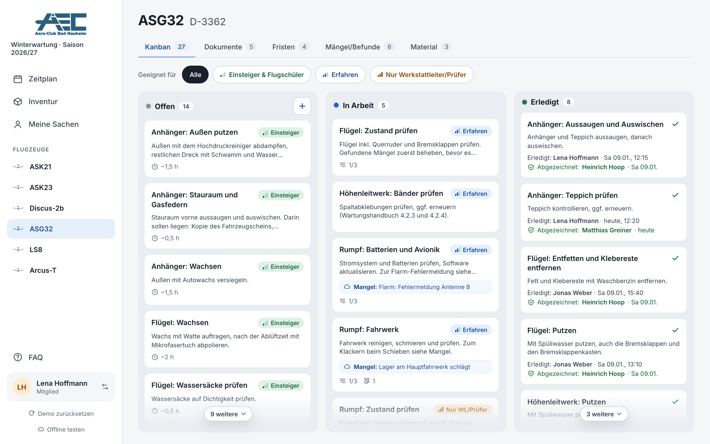

# Vereins-Wartung · Winterwartung für Segelflugvereine

Web-App, mit der ein Verein die Winterwartung seiner Segelflugzeuge plant und nachvollzieht:
wer arbeitet wann an welchem Flugzeug, was ist erledigt und abgezeichnet, welche Mängel sind offen und was muss bestellt werden.
Alles an einem Ort – am Werkstatt-Tablet genauso wie zu Hause im Browser.

Entstanden für den **Aero-Club Bad Nauheim** (läuft dort unter [wartung.aecbn.de](https://wartung.aecbn.de)).
Jeder Verein kann sie auf einem eigenen Server betreiben, siehe [Eigener Server](#eigener-server).



<details>
<summary>Zeitplan mit Saisonplan und Werkstatt-Terminen</summary>


</details>

**Demo mit Beispieldaten:** die GitHub-Pages-Seite dieses Repos. Änderungen dort bleiben im eigenen Browser und lassen sich über „Demo zurücksetzen“ verwerfen.

## Funktionen

- **Zeitplan:** Saisonplan, welches Flugzeug wann in der Werkstatt ist, Werkstattleitung pro Samstag
- **Pro Flugzeug:** Kanban-Board mit Checklisten und Abzeichnung, Dokumente, Fristen, Mängel/Befunde mit Fotos, Material
- **Inventur:** Bestand mit Lagerort und Bestellliste bis zur Lieferung
- **Meine Sachen:** eigene Karten, Mängel und Bestellungen auf einen Blick
- **Verwaltung:** Saisons aus Kanban-Vorlagen, Flugzeuge, Konten und Rollen
- **Anmeldung:** Mitglieder nur mit Namen, Werkstattleitung, Admins und Werkstatt-Tablet mit Passwort
- **Offline:** weiterarbeiten ohne Netz, Änderungen gehen beim Wiederverbinden raus

## Eigener Server

Jeder Verein kann die App auf einem eigenen Server mit eigenem Namen und Logo betreiben. Es gibt ein fertiges Docker-Image, gebaut werden muss nichts.

Benötigt werden:
- ein Linux-Server mit Docker (ein kleiner VPS reicht)
- eine (Sub-)Domain, die auf den Server zeigt
- ein Webserver davor für HTTPS, z. B. nginx mit Let's Encrypt
- Logo des Vereins als PNG oder SVG

Die Schritt-für-Schritt-Anleitung steht in [docs/eigener-server.md](docs/eigener-server.md).

## Entwickeln

Voraussetzung: Node.js 22 oder neuer.

```bash
cd frontend
npm install
npm run dev
```

Die Seite läuft dann unter http://localhost:5173 als Demo mit Beispieldaten.
Gegen den echten Server lokal: siehe [backend/README.md](backend/README.md).

| Befehl (in `frontend/`) | Zweck |
| --- | --- |
| `npm run dev` | Entwicklungsserver mit Hot Reload |
| `npm run build` | Typprüfung und statischer Build nach `dist/` |
| `npm run preview` | den Build lokal ansehen |

**Technik:** Vue 3, Vue Router, Vite, TypeScript, eigenes CSS; Server mit Hono, SQLite und Drizzle. Code-Struktur und Konventionen stehen in [CLAUDE.md](CLAUDE.md), der Vertrag zwischen App und Server in [docs/backend.md](docs/backend.md).

**Veröffentlichen:** jeder Push auf `main` baut die Demo für GitHub Pages (`.github/workflows/deploy.yml`) und das Server-Image (`.github/workflows/deploy-server.yml`).

**Mitmachen:** Verbesserungen gern als Pull Request. Direkt auf `main` pushen nur die Maintainer.

## Geplant

- **Anbindung an Vereinsflieger** für Fristen und Mängel
- **PWA** für die Nutzung am Tablet auch ohne Netz
